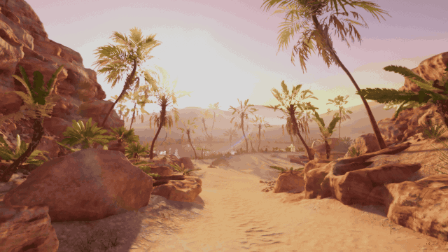

<header>

# **Demo-Sample**

***Proyecto de muestra basado en el URP 3D Sample de Unity (escenas Cockpit, Garden, Oasis y Terminal).***

</header>

## Preview

## Requirements

* Unity: 6000.3.27f1
* Render Pipeline: Universal Render Pipeline (URP)
* Required packages/tools:
  * Visual Effect Graph
  * Input System

## Usage

1. Clona el repositorio y ábrelo con Unity 6000.3.27f1 (Unity Hub → Add project from disk).
2. Abre la escena principal:
   * `Assets/Scenes/Terminal/TerminalScene.unity` (o Cockpit / Garden / Oasis)

## Notes

* El contenido de muestra es de Unity Technologies y está sujeto a la [Unity Companion License](https://unity.com/legal/licenses/unity-companion-license).
